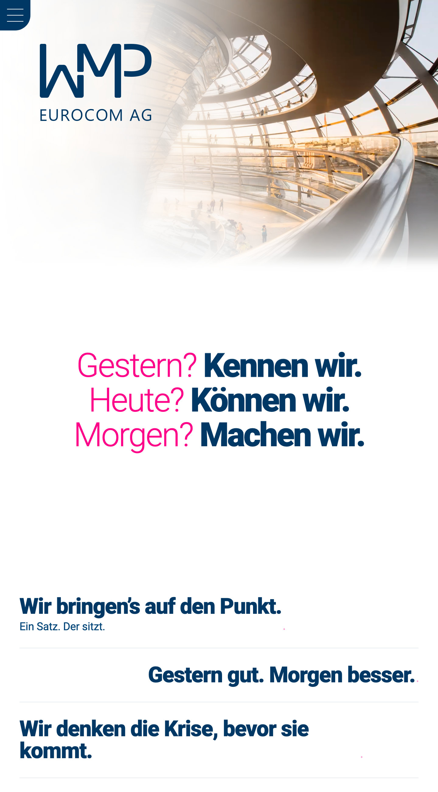
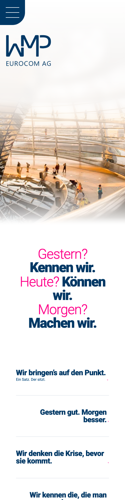

# WMP website redesign

Redesign prototype for the wmp-ag.de homepage. It is the saved live homepage with seven
custom sections (team, Zahlen, Leistungen, Karriere, Geschichte, Partnernetzwerk, Kontakt),
plus a template for the ten service detail pages.

**Status: work in progress, not yet code-reviewed.**

## Branches

- `main`: the redesign as first snapshotted.
- `claims`: a variant with a new video hero, the main claim and eight short claims in
  "Was wir können", which moves directly after the hero, and a scroll-linked transition between
  the two.

| Desktop | Mobile |
|---|---|
|  |  |

## Run it

```
./serve.sh        # http://localhost:8935/
```

Open it through the local server, not by double-clicking `index.html`: relative asset paths and
the globe's WebGL texture don't load from `file://`.

## Files

- `index.html` — the homepage
- `leistung.html?s=<slug>` — service detail pages, e.g. `?s=krisenkommunikation`
- `wp-content/uploads/wmp-redesign-assets/` — portraits, globe texture, map and service images
- `index.html.original-backup` — the unmodified saved live page, kept for reference

Theme CSS/JS and fonts still load from `https://wmp-ag.de`, so the page needs a connection.

## Plan

The target is a WordPress plugin with one shortcode per section. The plan and the open
items live in the author's workspace (issue tracker and WordPress port notes).
